<!-- ═══════════════════════════  HEADER  ═══════════════════════════ -->

  

  

  
  
  

  
  
  
  
  <!-- Add more once you have the handles:
  
  
  -->

 

<!-- ═══════════════════════════  ABOUT  ═══════════════════════════ -->

  

<!-- ═══════════════════════════  PROJECTS  ═══════════════════════════ -->
<h2 align="center">🚀 Featured Work</h2>

<table>
  <tr>
    <td width="50%" valign="top">
      <h3>📦 SupplAI · Buyer Dashboard</h3>
      
Buyer side of an AI-driven supply chain platform. I built the <b>agentic AI assistant</b> with its own knowledge base and a <b>web-scraping chatbot</b>.

      

        
        
        
        
        
      

      
      
    </td>
    <td width="50%" valign="top">
      <h3>🎙️ Prep-Pulse</h3>
      
AI mock-interview platform. A real-time <b>voice agent</b> runs the interview, <b>Gemini</b> writes role-specific questions, and <b>face expression analysis</b> scores how you came across.

      

        
        
        
        
        
      

      
      
    </td>
  </tr>
  <tr>
    <td width="50%" valign="top">
      <h3>🌍 LangQuest</h3>
      
Desktop app for learning a new language through <b>scene-based conversations</b>, voiced by lifelike <b>Murf AI</b> speech.

      

        
        
        
        
        
      

      
      
    </td>
    <td width="50%" valign="top">
      <h3>🤝 Hackathons &amp; Collabs</h3>
      

        ⚡ <a href="https://github.com/rcciit-swc/techtrix-2026"><b>TechTrix 2026</b></a>: hero section, events cluster and navbar for RCCIIT's tech fest site  
        🌊 <a href="https://github.com/FloatChatSIH/Frontend"><b>FloatChat · SIH</b></a>: filters and dialog UI for the hackathon frontend  
        🛍️ <a href="https://github.com/SupplAI-Organization/sellers-dashboard-standardized"><b>SupplAI Seller Dashboard</b></a>: shared layout, discount and order fixes
      

      
    </td>
  </tr>
</table>

<!-- ═══════════════════════════  TECH  ═══════════════════════════ -->
<h2 align="center">🛠️ Tech Arsenal</h2>

<table>
  <tr>
    <td align="center" width="150"><b>💻 Languages</b></td>
    <td>
      
      
      
      
      
    </td>
  </tr>
  <tr>
    <td align="center"><b>🎨 Frontend</b></td>
    <td>
      
      
      
    </td>
  </tr>
  <tr>
    <td align="center"><b>⚙️ Backend</b></td>
    <td>
      
      
    </td>
  </tr>
  <tr>
    <td align="center"><b>🗄️ Data</b></td>
    <td>
      
      
      
      
      
      
    </td>
  </tr>
  <tr>
    <td align="center"><b>☁️ DevOps</b></td>
    <td>
      
      
      
      
      
    </td>
  </tr>
</table>

<!-- ═══════════════════════════  STATS  ═══════════════════════════ -->
<h2 align="center">📊 GitHub Analytics</h2>

<!-- Cards are regenerated daily by .github/workflows/profile-cards.yml -->

  <!-- This card prints the Location field from your GitHub profile. Set it to "Kolkata, India" first, then uncomment:
  
  -->
  
  
  
  
  

<!-- ═══════════════════════════  3D CITY  ═══════════════════════════ -->
<h2 align="center">🌃 My Contribution Skyline</h2>

<!-- Regenerated daily by .github/workflows/profile-3d.yml (colours in .github/profile-3d-settings.json) -->

  

 

  

<!-- ═══════════════════════════  FOOTER  ═══════════════════════════ -->

  

<!-- Hidden Easter Egg -->
<!--
  _____  _                _
 |  __ \| |              | |
 | |  | | |__  _ __ _   _| |__   __ _
 | |  | | '_ \| '__| | | | '_ \ / _` |
 | |__| | | | | |  | |_| | |_) | (_| |
 |_____/|_| |_|_|   \__,_|_.__/ \__,_|

 Thanks for checking out my profile! 🚀
-->
